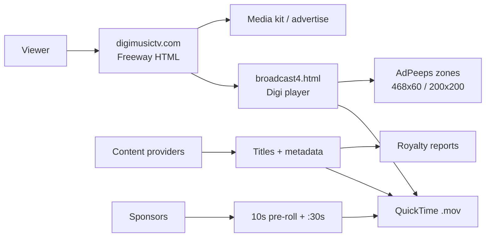

# Architecture

How DigiMusic TV’s QuickTime Digi player channel and network stack worked, reconstructed from the surviving site export and Freeway project history.

---

## Product shape

DigiMusic TV was a **vertical streaming network** for the music community:

1. **Site** — Freeway-authored marketing / connect / advertise / store pages
2. **Channel** — Digi player console experience (`broadcast4.html`)
3. **Inventory** — sponsor pre-rolls + AdPeeps display zones
4. **Supply** — content-provider agreements + original in-house production
5. **Settlement** — royalty reporting against distributed titles

---

## QuickTime Digi player (`broadcast4.html`, ~2008)

Custom “console” chrome (sliced background art, Channel Guide / Advertise / Help, QT7 badge) wrapping a QuickTime `<embed>` in a layer named `DMTStream`.

Exported snapshot behavior:

- `src` → `http://www.digimusictv.com/movies/bluecataudiopr2.mov`
- `autoplay=true`, `loop=false`, `kioskmode=true`
- Progressive HTTP delivery from the DigiMusic host (not a separate RTSP URL in the HTML)

Earlier Freeway revisions show a richer QT pattern (`DMTStream2`):

- Looping `poster.mov` as the starter
- `href` + `target="myself"` to replace the poster with the next clip (e.g. `digimusictvintro.mov`)
- Business copy describing a **10-second sponsor pre-roll** on every channel access, plus mid-roll :30s

So the intended viewer path was: **open channel → preroll / poster kickoff → program content**, with “what’s on” swapped by updating the `.mov` pointed at the player (and/or chaining via QT `href`).

### Channel / promo `.mov` titles

| URL path | Role |
|----------|------|
| `/movies/bluecataudiopr2.mov` | Channel program in `broadcast4` export |
| `/movies/bluecataudiopr.mov` | Earlier Blue Cat PR |
| `/digimusictvintro.mov` | Site / channel intro |
| `/movies/digimusictv.comintro2.mov` / `intro3.mov` | Intro iterations |
| `/movies/maudiopr.mov`, `/movies/vonagepr.mov` | Sponsor / partner PR |
| `/poster.mov` | QT poster / kickoff |

Upload path for site assets: FTP host referenced in project files as `ftp.digimusictv.com/www`.

---

## Site + monetization

AdPeeps ran on-domain (`/adpeeps/adpeeps.php`) with named zones per page (Home, Mission, `DMT_Channel_*`, etc.).

---

## Production

Original DigiMusic programming was shot and edited in-house (founder-operated). The network also licensed / carried partner titles via content-provider paperwork (e.g. What is Indie, Under The Radar) and PSA agreements (e.g. Music In Schools Today).

---

## What this archive is *not*

- Not a runnable modern streaming stack (QuickTime browser plugins are gone)
- Not a complete CMS or encoder pipeline dump
- Not a claim of inventing consumer streaming ahead of Netflix/Hulu — it is an independent vertical network built in that early window
