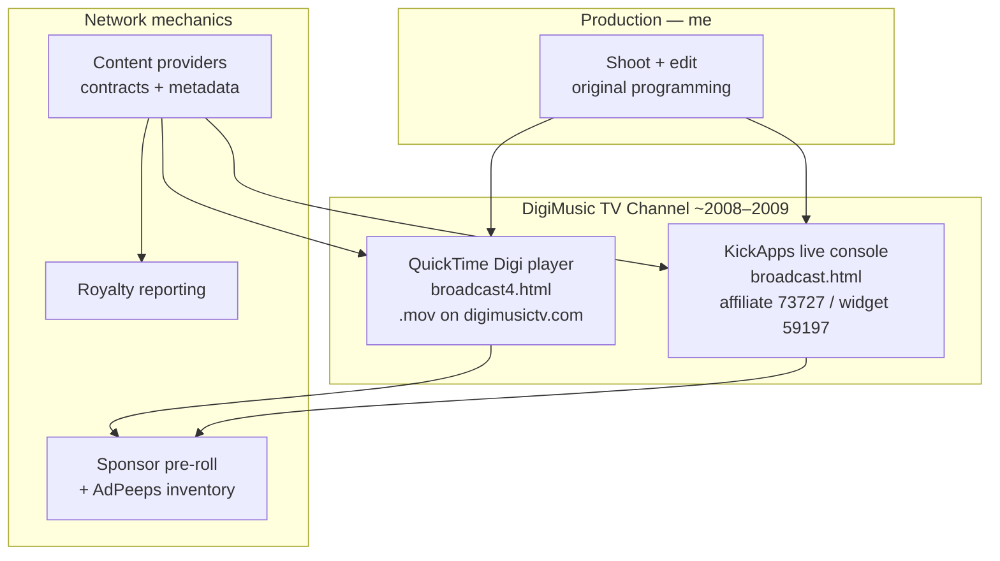

# DigiMusic TV — Independent Streaming Network (Showcase)

An independent music-community streaming network I built and operated around **2008** — including the website, channel player, monetization model, content-provider deals, and **original programming I shot and edited**.

This is the project that pulled me into tech on my own: founder, builder, and creator at once, during the same early era when consumer streaming TV was still taking shape.

Archival / portfolio material only. Not a live product.

---

## The story

In the late 2000s, streaming video on the open web was still an emerging idea. Alongside that wave, I independently stood up **DigiMusic TV** (`digimusictv.com`) — a broadband channel aimed at musicians and the music community:

- Original interviews, educational segments, history, and events across genres
- A custom “Digi player” channel UI (QuickTime era), later a KickApps live console
- Sponsor **pre-rolls** and mid-roll ad inventory
- Signed **content-provider** relationships and royalty reporting
- Hands-on production: I shot and edited the network’s original content

This repository packages the surviving site archive, media kit, contracts, and channel-player evidence as a public-facing retro portfolio.

---

## What you will find here

| Path | Contents |
|------|----------|
| [`site-archive/`](./site-archive) | Exported DigiMusic TV website (HTML/PHP + curated Resources) |
| [`receipts/`](./receipts) | Media kit, content-provider contracts, PSA agreements, royalty report, partner promo |
| [`snippets/`](./snippets) | Channel embed excerpts (QuickTime → KickApps) |
| [`MEDIA/`](./MEDIA) | Branding + channel UI stills |
| [`ARCHITECTURE.md`](./ARCHITECTURE.md) | How the channel stack evolved |
| [`TIMELINE.md`](./TIMELINE.md) | Dated evidence from the archive |
| [`DISCLAIMER.md`](./DISCLAIMER.md) | Rights, archival context, publish checklist |

---

## Architecture (short)



See [ARCHITECTURE.md](./ARCHITECTURE.md) for the QuickTime preroll/chain details and KickApps transition.

---

## Stack (era-accurate)

| Layer | Tech |
|-------|------|
| Site authoring | Softpress Freeway 4 Pro → HTML 4 / light PHP |
| Channel v1 | Apple QuickTime embed, progressive `.mov` on own host |
| Channel v2 | KickApps / `serve.a-widget.com` Flash live widget |
| Ads | Self-hosted AdPeeps zones (channel + site) |
| Sharing | AddThis / SendToFriends |
| Analytics | Google Analytics (Urchin) |

---

## Dated proof (filesystem receipts)

These are original archive timestamps — the “I was building this then” evidence. Full table: [TIMELINE.md](./TIMELINE.md).

| Date | Proof |
|------|--------|
| **2008-03** | Signed content-provider / PSA paperwork (What is Indie, Music In Schools Today, Under The Radar) |
| **2008-06-04** | Stand Alone Productions royalty report |
| **2008-08-22** | Media kit brochure (`Alternative Solution Brochure.pdf`) |
| **2008-11-09** | `broadcast4.html` — QuickTime Digi player channel |
| **2009-03-06** | `broadcast.html` — KickApps live console + site refresh |

```text
2008-03 deals → 2008-06 royalties → 2008-08 media kit → 2008-11 QT channel → 2009-03 Kick live
```

### Where the files live

1. **Media kit** — [`receipts/media-kit/`](./receipts/media-kit)
2. **Contracts / PSAs** — [`receipts/contracts/`](./receipts/contracts)
3. **Royalty report** — [`receipts/royalty/`](./receipts/royalty)
4. **Channel pages** — [`site-archive/broadcast4.html`](./site-archive/broadcast4.html), [`site-archive/broadcast.html`](./site-archive/broadcast.html)
5. **Partner promo** — [`receipts/partner-promo/`](./receipts/partner-promo)

> Before making this repository public, review signed PDFs and the royalty package for third-party PII. See [DISCLAIMER.md](./DISCLAIMER.md).

---

## Channel highlights

| Era | Page | What it did |
|-----|------|-------------|
| ~2008 | `broadcast4.html` | Custom Digi player UI; QuickTime autoplay of channel `.mov` (e.g. `movies/bluecataudiopr2.mov`) |
| ~2009 | `broadcast.html` | Full-bleed KickApps widget (`affiliateSiteId: 73727`, `widgetId: 59197`) + console ad zone |

Illustrative embeds: [`snippets/`](./snippets).

---

## How to browse the site archive locally

```bash
cd site-archive
python3 -m http.server 8080
# open http://localhost:8080/default.html
# channel UI: http://localhost:8080/broadcast4.html
```

Remote media (`.mov`, Kick Flash, AdPeeps) will not play in modern browsers — the layout, copy, and embed code are the historical record.

---

## Disclaimer

See [DISCLAIMER.md](./DISCLAIMER.md). Portfolio / archival showcase only.
