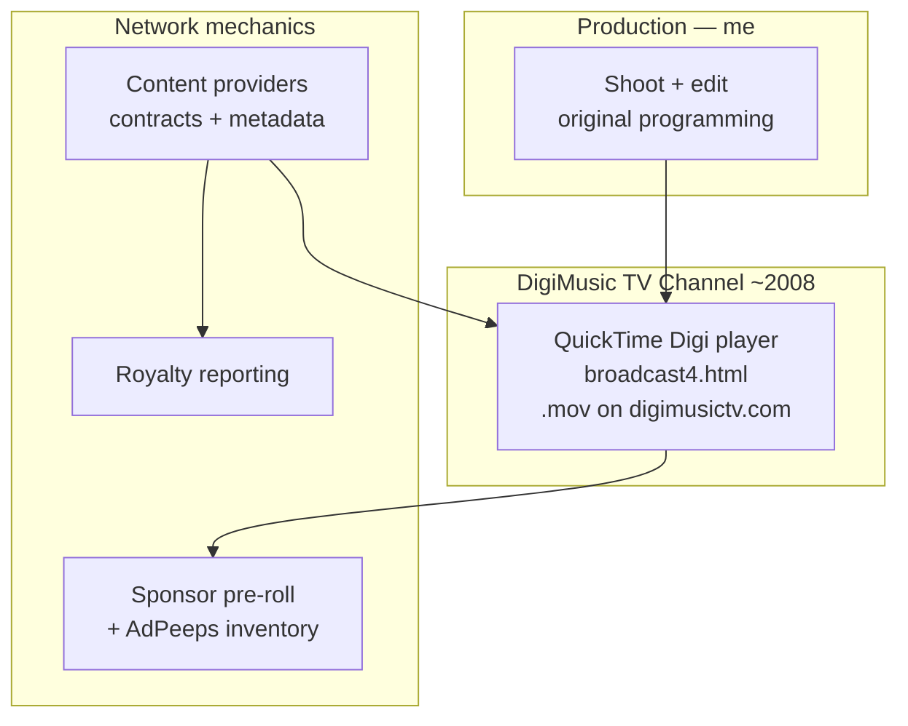
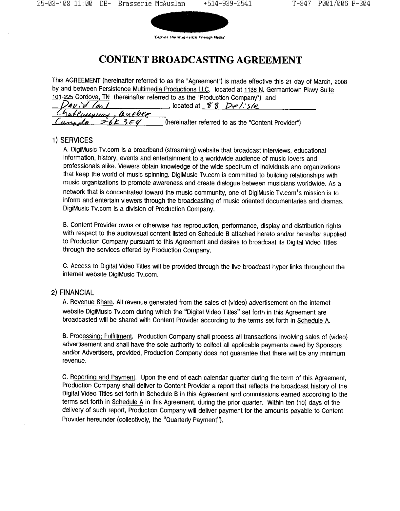
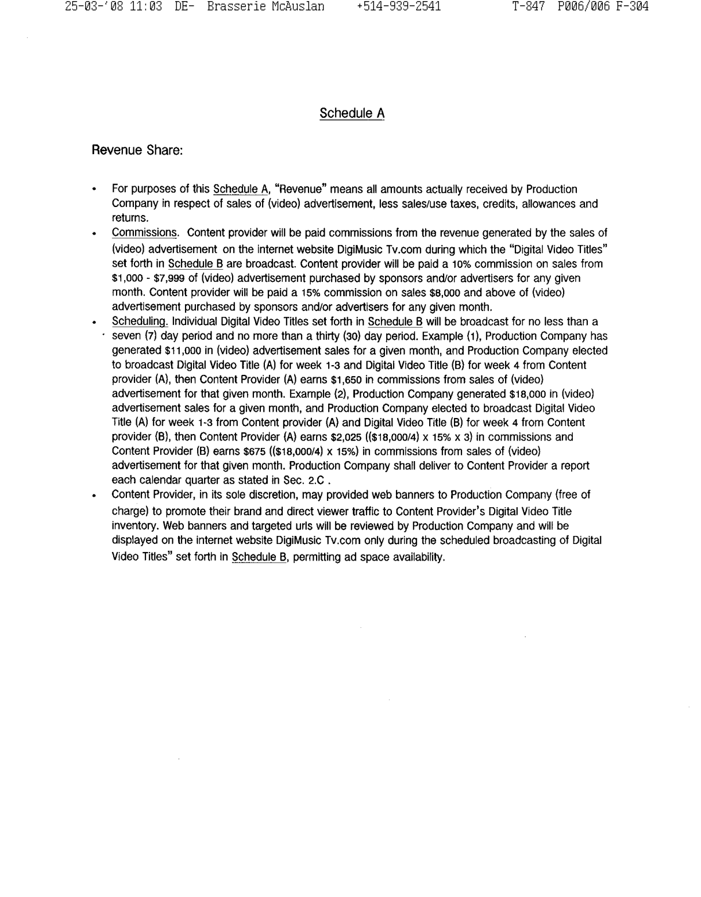
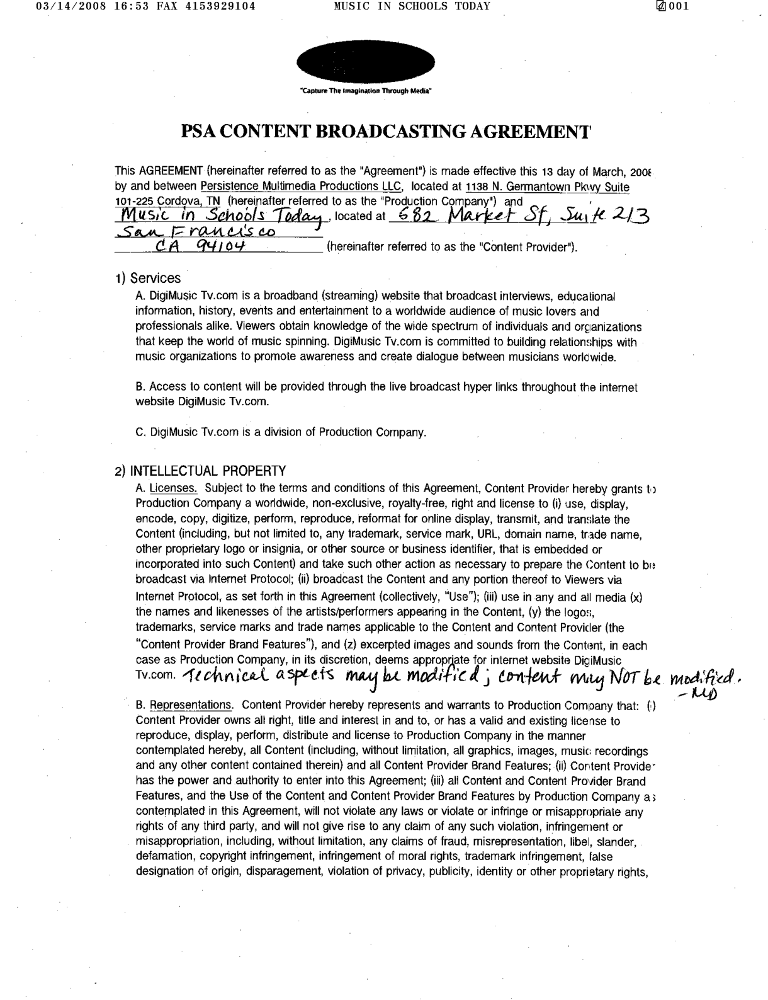
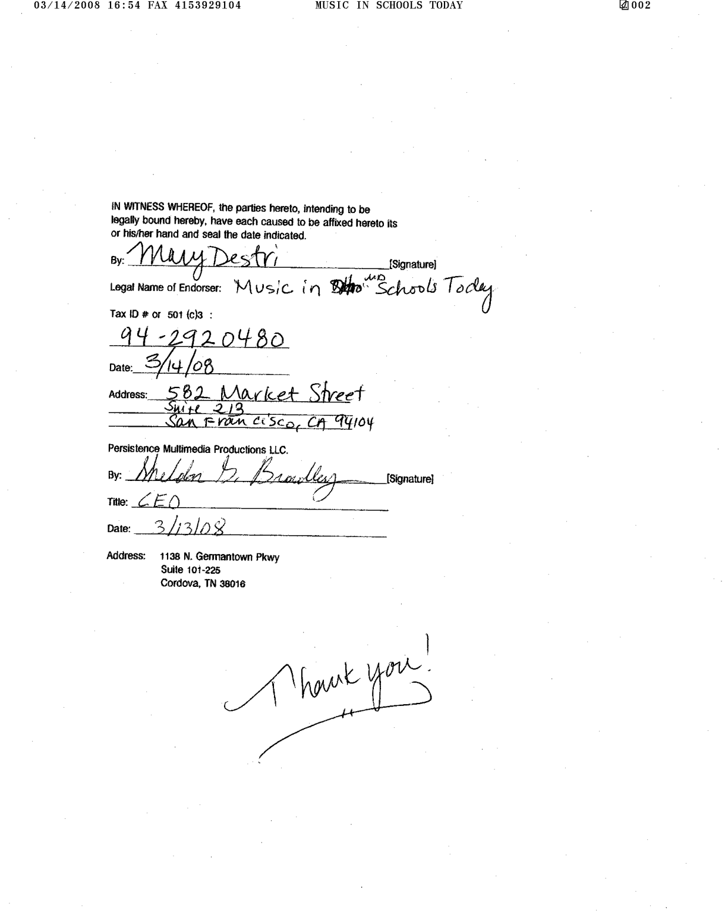
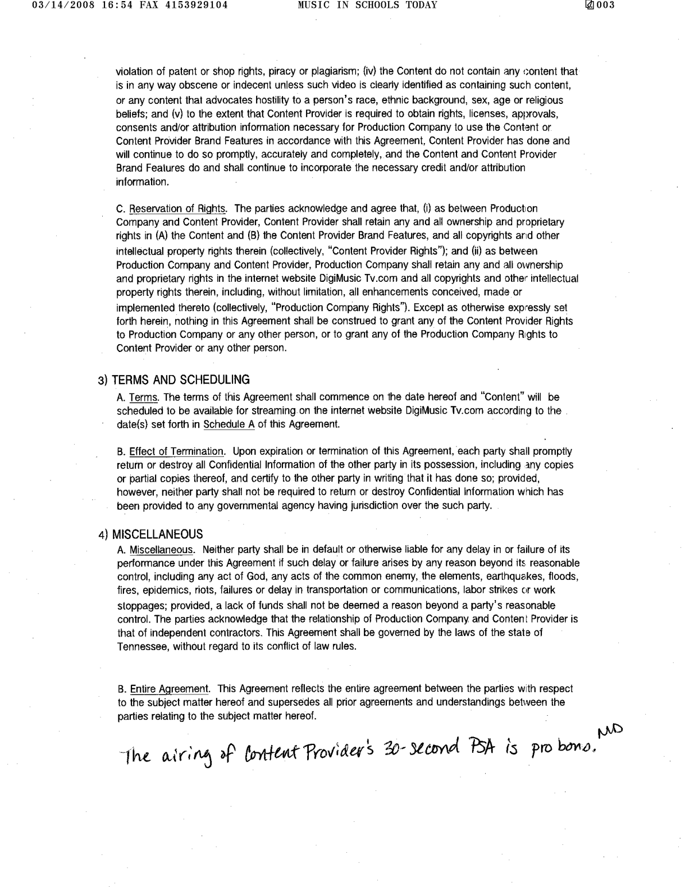

## The story

This is the indie project that ushered me into tech and I have never looked back.

With no formal training in coding — just a passion for creativity and music, and curiosity about building something with code — I independently stood up **DigiMusic TV** (`digimusictv.com`) in the late 2000s, when streaming video on the open web was still an emerging idea. It was a broadband channel aimed at musicians and the music community.

I self-funded the whole stack: my own cameras and laptops, an Apple rack server, and a dedicated T1 internet connection to host and deliver the channel.

What I built and ran:

- Original interviews, educational segments, history, and events across genres
- A custom **Digi player** channel UI powered by Apple QuickTime progressive `.mov` delivery
- Sponsor **pre-rolls** and mid-roll ad inventory
- Signed **content-provider** relationships and royalty reporting
- Hands-on production: I shot and edited the network’s original content

This repository packages the surviving site archive, media kit, contract page previews, and Digi player evidence as a public-facing retro portfolio.

---

# DigiMusic TV — Independent Streaming Network (2008 Showcase)

An independent music-community streaming network I built and operated around **2008** — including the website, QuickTime Digi player channel, monetization model, content-provider deals, and **original programming I shot and edited**.

This is the project that pulled me into tech on my own: founder, builder, and creator at once, during the same early era when consumer streaming TV was still taking shape.

Archival / portfolio material only. Not a live product. This showcase focuses on the **QuickTime Digi player era**.

---

## What you will find here

| Path | Contents |
|------|----------|
| [`site-archive/`](./site-archive) | Exported DigiMusic TV website (HTML/PHP + curated Resources) |
| [`receipts/`](./receipts) | Media kit, contract page previews, royalty report, partner promo |
| [`snippets/`](./snippets) | QuickTime Digi player embed excerpt |
| [`MEDIA/`](./MEDIA) | Branding + channel UI stills |
| [`ARCHITECTURE.md`](./ARCHITECTURE.md) | How the QuickTime channel stack worked |
| [`TIMELINE.md`](./TIMELINE.md) | Dated evidence from the archive |
| [`DISCLAIMER.md`](./DISCLAIMER.md) | Rights, archival context, publish checklist |

---

## Architecture (short)



See [ARCHITECTURE.md](./ARCHITECTURE.md) for preroll / poster-movie chaining details.

---

## Stack (era-accurate)

| Layer | Tech |
|-------|------|
| Site authoring | Softpress Freeway 4 Pro → HTML 4 / light PHP |
| Channel | Apple QuickTime embed, progressive `.mov` on own host |
| Ads | Self-hosted AdPeeps zones (channel + site) |
| Sharing | AddThis / SendToFriends |
| Analytics | Google Analytics (Urchin) |

---

## Dated proof (filesystem receipts)

These are original archive timestamps — the “I was building this then” evidence. Full table: [TIMELINE.md](./TIMELINE.md).

| Date | Proof |
|------|--------|
| **2008-03** | Content-provider / PSA agreement page scans (What is Indie, Music In Schools Today) |
| **2008-06-04** | Stand Alone Productions royalty report |
| **2008-08-22** | Media kit brochure (`Alternative Solution Brochure.pdf`) |
| **2008-11-09** | `broadcast4.html` — QuickTime Digi player channel |

```text
2008-03 deals → 2008-06 royalties → 2008-08 media kit → 2008-11 QT Digi player channel
```

### Where the files live

1. **Media kit** — [`receipts/media-kit/`](./receipts/media-kit)
2. **Contract previews** — [`receipts/contract-previews/`](./receipts/contract-previews)
3. **Royalty report** — [`receipts/royalty/`](./receipts/royalty)
4. **Channel page** — [`site-archive/broadcast4.html`](./site-archive/broadcast4.html)
5. **Partner promo** — [`receipts/partner-promo/`](./receipts/partner-promo)

---

## Channel highlight

| Page | What it did |
|------|-------------|
| `broadcast4.html` (2008-11-09) | Custom Digi player UI; QuickTime autoplay of channel `.mov` (e.g. `movies/bluecataudiopr2.mov`) |

Illustrative embed: [`snippets/01-quicktime-channel-embed.html`](./snippets/01-quicktime-channel-embed.html).


### Channel previews and promos


https://github.com/user-attachments/assets/7e84cc70-d7a2-44e9-b63c-9b1e4cb531d2

https://github.com/user-attachments/assets/0befe6a4-fbc4-4f9a-b255-6a8b419ff9b9

https://github.com/user-attachments/assets/ad8e09a0-c8a4-4c57-8a95-b080c67c828d

https://github.com/user-attachments/assets/2b2a9c3d-b27d-4894-9798-a7f17d96b551

---

### Contract preview images

**What is Indie — Content Broadcasting Agreement** (first + last page)





**Music In Schools Today Agreement (signed)** (all pages)







> Preview images and the royalty package may include third-party details. See [DISCLAIMER.md](./DISCLAIMER.md).


## How to browse the site archive locally

```bash
cd site-archive
python3 -m http.server 8080
# open http://localhost:8080/default.html
# channel UI: http://localhost:8080/broadcast4.html
```

Remote media (`.mov`, AdPeeps) will not play in modern browsers — the layout, copy, and embed code are the historical record.

---

## Disclaimer

See [DISCLAIMER.md](./DISCLAIMER.md). Portfolio / archival showcase only.
